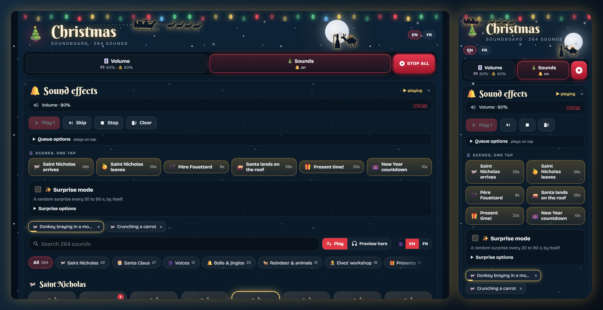

# 🎄 Christmas Soundboard

A free, festive soundboard for December: 297 sound effects (sleigh bells, Santa's "ho ho ho",
Saint Nicholas, his donkey and his knock at the door, elves at work, presents, a crackling fire,
New Year's countdown...) and 44 carols and ambiences you can mix together. Tap a sound and it
plays. Tap several and they line up. Or turn on **surprise mode** and let it play by itself, and
**hush** so it falls silent at the slightest noise. Voices in English and French, carols sung in
English, French and German. Works offline. No sign-up, no ads.

**▶ Open it: https://mayerwin.github.io/christmas-soundboard/**



## What it does

- **🫏 Saint Nicholas' Eve, ready to go.** His little bells, his donkey braying and clip-clopping
  up the path, three knocks on the door, and Saint Nicholas himself asking whether the children
  have been good (Père Fouettard too, for the cheeky ones).
- **🎅 Santa's night.** Sleigh bells landing on the roof, reindeer, the chimney, cookies and milk,
  "Ho ho ho! Merry Christmas!".
- **🗣️ Voices in English and French.** Every character speaks both. The 🗣️ EN / FR switch above
  the sounds shows one language or both; it starts with the language of the page.
- **✨ Surprise mode.** A random sound every few seconds (you choose the range, say 20 to 90 s),
  from all categories, the ones you pick, or your favourites only. Hide the phone, walk away.
- **🤫 Hush at the slightest noise.** Elves wrapping presents all night, who freeze when someone
  comes down the stairs: turn it on in the Settings tab and the phone listens with its microphone.
  At a noise, every sound fades out at once and comes back 10 s after the last one (you choose,
  3 to 60 s). It knows what it is playing, so its own sounds don't set it off, even through a
  Bluetooth speaker. A sensitivity slider, and a 30 s test that draws what the microphone hears
  and the line a noise must cross. Off by default; nothing is recorded or sent anywhere.
- **🎶 Music and 🌫️ ambiences.** The background is split in two: tick a carol (or several, they
  play one after another) and lay ambiences under it, a crackling fire, the wind in the chimney,
  sleigh bells, a Christmas market, each at its own level from 0 to 150 %. Carols are sung in
  English, French and German, or played by bands and orchestras.
- **Settings tab.** One slider for the background, one for the effects, the hush, your data.
- **Presets.** Save a mix and its volumes under a name, bring it back with one tap.
- **Make it yours.** ♥ favourites float to the top, 👎 or 👁 hides what you don't like, and the
  History lets you undo a slip. **Preview here** auditions a sound before anyone else hears it.
- **English / Français.** The page follows your browser; switch it with EN / FR at the top.
  Sound titles are translated too, except what a voice says.
- **Offline app.** Install it from your browser's menu (or the "Install the app" button): it
  downloads every sound and then works without a
  connection. "Make it work offline" in the Settings tab does the same without installing.
- **Your data stays yours.** Everything is saved in your browser only. Export it, import it on
  another device, or reset it, from the Settings tab. The microphone (hush) is listened to in
  the page itself, 20 ms at a time, and never leaves it.

Best trick: on the evening of 5 December, pair your phone with a Bluetooth speaker near the front
door. Little bells, a donkey, three knocks, and Saint Nicholas says good evening. And on Christmas
Eve, leave the elves at work under the tree with surprise mode and hush on: they go quiet the
moment someone sneaks in.

## A sibling of the Halloween Soundboard

This is the same app as the [Halloween Soundboard](https://github.com/mayerwin/halloween-soundboard),
with another theme: the code is identical, the theme (its sounds, colours, snowy scene, words) is
data. [AGENTS.md](AGENTS.md) explains how the pieces fit.

## Is there a server?

No. It is a static website on GitHub Pages: the page, the sounds, and a small engine
(`src/soundboard-local.js`) that runs the queue, surprise mode and the background mix in your
browser. The hush listens in your browser too (an AudioWorklet in `src/soundboard-card.js`). A
service worker (`src/sw.js`) keeps it working offline.

The interface (`src/soundboard-card.js`) is the same card that can run on a Home Assistant
dashboard, where a server-side engine plays it through many speakers at once. The card talks to
whichever engine it is given through the same messages. [AGENTS.md](AGENTS.md) describes that
contract and what to know to build the Home Assistant side.

## Run it locally

```sh
node build.mjs          # src/ -> dist/, no dependencies (Node 18+)
npx serve dist          # or any static file server
```

`build.mjs` gives every script, stylesheet, font and data file a content hash in its name, every
sound a `?v=<hash>` in `library.json`, and the service worker the list of the new files, so a new
version is never mixed with a cached old one. Each push to `main` builds and publishes the site
with GitHub Actions (`.github/workflows/pages.yml`).

## Credits

The sounds belong to their authors and are used under their licenses: 88 under CC0 1.0 (public domain dedication), 87 under CC BY-NC 4.0, 56 under CC BY 4.0, 37 under Mixkit Sound Effects Free License (mixkit.co), 27 under BBC RemArc licence (BBC Sound Effects archive), 14 under Public domain, 11 under CC BY-SA 4.0, 8 under © Intellectual Reserve, Inc. (The Church of Jesus Christ of Latter-day Saints), personal non-commercial use, 7 under CC BY 3.0, 3 under CC BY-SA 3.0, 2 under CC BY-NC 3.0, 1 under CC BY-NC-SA 3.0.
We claim no rights over them. Sounds under CC BY-NC (and BY-NC-SA) may not be used commercially; the
Mixkit and BBC Sound Effects sounds stay under the Mixkit and BBC RemArc licenses. The carols come from
the Radio România archive (its choirs, CC BY-SA 4.0, on Europeana), Denis Richard and Ensemble Vocal
J-Vox (Jamendo, CC BY-SA / BY-NC-SA), US military bands (public domain) and The Church of Jesus Christ
of Latter-day Saints (© Intellectual Reserve, Inc., used here for personal, non-commercial purposes).
Every sound is trimmed of silence and loudness-matched. The character voices
(Saint Nicholas, Père Fouettard, Santa, the elf, the children, the party host) are synthesised with
[OmniVoice](https://github.com/k2-fsa/OmniVoice), whose model is licensed for non-commercial use,
so they are shared under CC BY-NC 4.0. The full list is in [CREDITS.md](CREDITS.md) and in the app
(footer, "Full credits").

<details>
<summary>Every sound, its author and license</summary>

| Sound | Category | Author | License | Source |
|---|---|---|---|---|
| Adeste Fideles waltz, music box and cello | Music | Kevin MacLeod (incompetech.com) | CC BY 4.0 | [link](https://incompetech.com/music/royalty-free/index.html?isrc=USUAN2100021) |
| Busy New Year's Eve dinner | Ambience | BBC | BBC RemArc licence (BBC Sound Effects archive) | [link](https://sound-effects.bbcrewind.co.uk/search?q=07011350) |
| Carol of the Bells, concert band | Music | United States Air Force Band of the Rockies (Concert Band) | Public domain | [link](https://commons.wikimedia.org/wiki/File:Carol_of_the_Bells_-_Concert_Band_-_United_States_Air_Force_Band_of_the_Rockies.mp3) |
| Christmas carol, antique music box | Music | thulitt | CC0 1.0 (public domain dedication) | [link](https://freesound.org/people/thulitt/sounds/150026/) |
| Christmas market crowd | Ambience | Pfannkuchn | CC0 1.0 (public domain dedication) | [link](https://freesound.org/people/Pfannkuchn/sounds/457618/) |
| Christus ist geboren heut, sung | Music | The Church of Jesus Christ of Latter-day Saints (Hymns—For Home and Church) | © Intellectual Reserve, Inc. (The Church of Jesus Christ of Latter-day Saints), personal non-commercial use | [link](https://www.churchofjesuschrist.org/media/music/songs/he-is-born-the-divine-christ-child?lang=deu) |
| Church bells ringing on Christmas Day | Ambience | vonfleisch | CC BY 3.0 | [link](https://freesound.org/people/vonfleisch/sounds/212037/) |
| Cosy fireplace fire | Ambience | NoOneIsReal | CC0 1.0 (public domain dedication) | [link](https://freesound.org/people/NoOneIsReal/sounds/387128/) |
| Crackling wood fire | Ambience | Graham Ross / BBC Natural History Unit | BBC RemArc licence (BBC Sound Effects archive) | [link](https://sound-effects.bbcrewind.co.uk/search?q=NHU05008080) |
| Dance of the Sugar Plum Fairy, orchestra | Music | Kevin MacLeod (incompetech.com) | CC BY 4.0 | [link](https://incompetech.com/music/royalty-free/index.html?isrc=USUAN1100270) |
| Deck the Halls, peppy | Music | Kevin MacLeod (incompetech.com) | CC BY 4.0 | [link](https://incompetech.com/music/royalty-free/index.html?isrc=USUAN1100368) |
| Douce nuit, choir | Music | Ensemble Vocal J-Vox | CC BY-NC-SA 3.0 | [link](https://archive.org/details/jamendo-101735) |
| Entre le bœuf et l'âne gris, sung | Music | Denis Richard | CC BY-SA 3.0 | [link](https://archive.org/details/jamendo-080882) |
| Fire crackling in the fireplace | Ambience | silencyo | CC0 1.0 (public domain dedication) | [link](https://freesound.org/people/silencyo/sounds/81801/) |
| Horse-drawn sleigh ride | Ambience | BBC | BBC RemArc licence (BBC Sound Effects archive) | [link](https://sound-effects.bbcrewind.co.uk/search?q=07000055) |
| Il est né le divin enfant, jazzy brass | Music | United States Air Force Band of the Rockies (Galaxy Brass) | Public domain | [link](https://commons.wikimedia.org/wiki/File:Le_Divin_Enfant_-_Galaxy_Brass_-_United_States_Air_Force_Band_of_the_Rockies.mp3) |
| Il est né le divin enfant, soprano and piano | Music | The Church of Jesus Christ of Latter-day Saints (Hymns—For Home and Church) | © Intellectual Reserve, Inc. (The Church of Jesus Christ of Latter-day Saints), personal non-commercial use | [link](https://www.churchofjesuschrist.org/media/music/songs/he-is-born-the-divine-christ-child?lang=fra) |
| Jingle Bells, cheerful band | Music | Kevin MacLeod (incompetech.com) | CC BY 4.0 | [link](https://incompetech.com/music/royalty-free/index.html?isrc=USUAN1100889) |
| Joy to the World, children's choir and brass | Music | Radio România Children's Choir (Corul de Copii Radio), cond. Voicu Popescu, with the Radio Brass Quintet | CC BY-SA 4.0 | [link](https://culturalia.ro/entities/b4993100-ab99-4bd4-a45a-bf773e0997a7/view) |
| Les anges dans nos campagnes, sung | Music | Denis Richard | CC BY-SA 3.0 | [link](https://archive.org/details/jamendo-080882) |
| Minuit, chrétiens, chamber choir | Music | Preludiu Chamber Choir (Corul de cameră Preludiu), cond. Voicu Enăchescu | CC BY-SA 4.0 | [link](https://culturalia.ro/entities/53d767df-aac6-4eb8-87c8-d3a8c2fb3e8d/view) |
| Mon beau sapin, sung | Music | Denis Richard | CC BY-SA 3.0 | [link](https://archive.org/details/jamendo-080882) |
| Noël nouvelet, children's choir | Music | Radio România Children's Choir (Corul de Copii Radio), cond. Voicu Popescu | CC BY-SA 4.0 | [link](https://culturalia.ro/entities/22a8e042-1358-47ed-9c11-e894d75de1d3/view) |
| Nouvelle Noël, jazzy bells | Music | Kevin MacLeod (incompetech.com) | CC BY 4.0 | [link](https://incompetech.com/music/royalty-free/index.html?isrc=USUAN1700072) |
| O Come, All Ye Faithful, choir and brass | Music | Radio România Academic Choir (Corul Academic Radio), cond. Voicu Popescu, with the Romanian Brass Quintet | CC BY-SA 4.0 | [link](https://culturalia.ro/entities/314748e0-3eac-4fff-86b1-83ab67be9c6b/view) |
| O Holy Night, concert band | Music | United States Air Force Band of the Golden West (Concert Band) | Public domain | [link](https://commons.wikimedia.org/wiki/File:Cantique_de_No%C3%ABl_(O_Holy_Night)_-_Concert_Band_-_United_States_Air_Force_Band_of_the_Golden_West.mp3) |
| Parade of the Wooden Soldiers, concert band | Music | United States Air Force Band of Mid-America (Concert Band) | Public domain | [link](https://commons.wikimedia.org/wiki/File:Parade_of_the_Wooden_Soldiers_-_Concert_Band_-_United_States_Air_Force_Band_of_Mid-America.mp3) |
| Quel est l'Enfant ?, voice and piano | Music | The Church of Jesus Christ of Latter-day Saints (Hymns—For Home and Church) | © Intellectual Reserve, Inc. (The Church of Jesus Christ of Latter-day Saints), personal non-commercial use | [link](https://www.churchofjesuschrist.org/media/music/songs/what-child-is-this?lang=fra) |
| Silent Night, choir and organ | Music | The Church of Jesus Christ of Latter-day Saints (Hymns (1985)) | © Intellectual Reserve, Inc. (The Church of Jesus Christ of Latter-day Saints), personal non-commercial use | [link](https://www.churchofjesuschrist.org/media/music/songs/silent-night?lang=eng) |
| Silent Night, piano | Music | Kevin MacLeod (incompetech.com) | CC BY 4.0 | [link](https://incompetech.com/music/royalty-free/index.html?isrc=USUAN1100075) |
| St Nicholas' Church bells | Ambience | BBC | BBC RemArc licence (BBC Sound Effects archive) | [link](https://sound-effects.bbcrewind.co.uk/search?q=07040020) |
| Still, still, still, choir and piano | Music | The Church of Jesus Christ of Latter-day Saints (Hymns—For Home and Church) | © Intellectual Reserve, Inc. (The Church of Jesus Christ of Latter-day Saints), personal non-commercial use | [link](https://www.churchofjesuschrist.org/media/music/songs/still-still-still?lang=deu) |
| Stille Nacht, chamber choir | Music | Preludiu Chamber Choir (Corul de cameră Preludiu), cond. Voicu Enăchescu | CC BY-SA 4.0 | [link](https://culturalia.ro/entities/1a9f0bfc-1b2a-4c3d-b2dd-8025244fba5a/view) |
| Stille Nacht, children's choir and brass | Music | Radio România Children's Choir (Corul de Copii Radio), cond. Voicu Popescu, with the Radio Brass Quintet | CC BY-SA 4.0 | [link](https://culturalia.ro/entities/dea32c45-a19c-48cc-8638-eb39b6f295a8/view) |
| Tout est calme enfin, choir | Music | The Church of Jesus Christ of Latter-day Saints (Hymns—For Home and Church) | © Intellectual Reserve, Inc. (The Church of Jesus Christ of Latter-day Saints), personal non-commercial use | [link](https://www.churchofjesuschrist.org/media/music/songs/still-still-still?lang=fra) |
| Up on the Housetop, bouncy | Music | Kevin MacLeod (incompetech.com) | CC BY 4.0 | [link](https://incompetech.com/music/royalty-free/index.html?isrc=USUAN1100365) |
| Waltz of the Flowers, Nutcracker | Music | U.S. Army Band "Pershing's Own" | Public domain | [link](https://commons.wikimedia.org/wiki/File:P.I._Tchaikovsky%27s_Waltz_of_the_Flowers_Performed_by_The_U.S._Army_Band,_c._2019.mp3) |
| We Wish You a Merry Christmas, orchestral | Music | Kevin MacLeod (incompetech.com) | CC BY 4.0 | [link](https://incompetech.com/music/royalty-free/index.html?isrc=USUAN1100369) |
| Wen wiegt Maria sanft im Arm?, voice and piano | Music | The Church of Jesus Christ of Latter-day Saints (Hymns—For Home and Church) | © Intellectual Reserve, Inc. (The Church of Jesus Christ of Latter-day Saints), personal non-commercial use | [link](https://www.churchofjesuschrist.org/media/music/songs/what-child-is-this?lang=deu) |
| Wenn ich ein Glöcklein wär, children's choir | Music | Radio România Children's Choir (Corul de Copii Radio), cond. Voicu Popescu | CC BY-SA 4.0 | [link](https://culturalia.ro/entities/c1c61941-ee6e-478e-8473-f4135e0f2391/view) |
| What Child Is This?, choir and piano | Music | The Church of Jesus Christ of Latter-day Saints (Hymns—For Home and Church) | © Intellectual Reserve, Inc. (The Church of Jesus Christ of Latter-day Saints), personal non-commercial use | [link](https://www.churchofjesuschrist.org/media/music/songs/what-child-is-this?lang=eng) |
| Wind moaning down the chimney | Ambience | BBC | BBC RemArc licence (BBC Sound Effects archive) | [link](https://sound-effects.bbcrewind.co.uk/search?q=07038340) |
| Winter night: wind in icy branches, light snow falling | Ambience | daveincamas | CC BY 4.0 | [link](https://freesound.org/people/daveincamas/sounds/65247/) |
| Wood fire in a living room fireplace | Ambience | flwrpwr | CC BY 3.0 | [link](https://freesound.org/people/flwrpwr/sounds/614885/) |
| Bar chimes sweeping up | Bells & jingles | pjcohen | CC BY 4.0 | [link](https://freesound.org/people/pjcohen/sounds/414559/) |
| Bells of Saint-Nicolas church, Wasquehal | Bells & jingles | Julien Massa | CC BY-SA 4.0 | [link](https://commons.wikimedia.org/wiki/File:Cloches_de_l%27%C3%A9glise_Saint-Nicolas_de_Wasquehal.ogg) |
| Christmas handbell ringing | Bells & jingles | Alexander (Orange Free Sounds) | CC BY 4.0 | [link](https://orangefreesounds.com/christmas-hand-bell-ringing-sound-effect/) |
| Christmas jingle bells | Bells & jingles | zoefitzgerald | CC BY-NC 4.0 | [link](https://freesound.org/people/zoefitzgerald/sounds/371221/) |
| Church bell calling | Bells & jingles | Mixkit | Mixkit Sound Effects Free License (mixkit.co) | [link](https://mixkit.co/free-sound-effects/bell/) |
| Church bell tolling in Strasbourg | Bells & jingles | SamuelGremaud | CC0 1.0 (public domain dedication) | [link](https://freesound.org/people/SamuelGremaud/sounds/411816/) |
| Church bells, final peal | Bells & jingles | Mixkit | Mixkit Sound Effects Free License (mixkit.co) | [link](https://mixkit.co/free-sound-effects/bell/) |
| Church bells in the distance | Bells & jingles | InspectorJ | CC BY 4.0 | [link](https://freesound.org/people/InspectorJ/sounds/412918/) |
| Church bells pealing | Bells & jingles | craigsmith | CC0 1.0 (public domain dedication) | [link](https://freesound.org/people/craigsmith/sounds/480014/) |
| Great bell of Notre-Dame de Paris on Christmas Day | Bells & jingles | Mxsmanic | CC0 1.0 (public domain dedication) | [link](https://freesound.org/people/Mxsmanic/sounds/139110/) |
| Horse trotting with sleigh bells | Bells & jingles | BBC | BBC RemArc licence (BBC Sound Effects archive) | [link](https://sound-effects.bbcrewind.co.uk/search?q=07039321) |
| Jingling sleigh bells | Bells & jingles | Alexander (Orange Free Sounds) | CC BY-NC 4.0 | [link](https://orangefreesounds.com/sleigh-bells-ringing-sound-effect-festive-holiday-jingle/) |
| Large handbell ringing | Bells & jingles | Tewkesound | CC BY 4.0 | [link](https://freesound.org/people/Tewkesound/sounds/140150/) |
| Paris church bells, clock striking twelve | Bells & jingles | BBC | BBC RemArc licence (BBC Sound Effects archive) | [link](https://sound-effects.bbcrewind.co.uk/search?q=07049101) |
| Sleigh bells coming and going | Bells & jingles | benjaminflack | CC BY-NC 4.0 | [link](https://freesound.org/people/benjaminflack/sounds/44293/) |
| Sleigh bells in rhythm | Bells & jingles | JustinAmolsch | CC BY 3.0 | [link](https://freesound.org/people/JustinAmolsch/sounds/547582/) |
| Sleigh bells jangling | Bells & jingles | InspectorJ | CC BY 4.0 | [link](https://freesound.org/people/InspectorJ/sounds/402521/) |
| Sleigh bells jingling, then fading | Bells & jingles | GowlerMusic | CC BY 4.0 | [link](https://freesound.org/people/GowlerMusic/sounds/265458/) |
| Sleigh bells ringing | Bells & jingles | BBC | BBC RemArc licence (BBC Sound Effects archive) | [link](https://sound-effects.bbcrewind.co.uk/search?q=07012094) |
| Sleigh bells shaken | Bells & jingles | Mixkit | Mixkit Sound Effects Free License (mixkit.co) | [link](https://mixkit.co/free-sound-effects/sleigh-bells/) |
| Small bell, single ping | Bells & jingles | steffcaffrey | CC0 1.0 (public domain dedication) | [link](https://freesound.org/people/steffcaffrey/sounds/452379/) |
| Wind chimes in the breeze | Bells & jingles | acclivity | CC BY-NC 4.0 | [link](https://freesound.org/people/acclivity/sounds/30606/) |
| Wind chimes | Bells & jingles | Mixkit | Mixkit Sound Effects Free License (mixkit.co) | [link](https://mixkit.co/free-sound-effects/win/) |
| Angels We Have Heard on High, a cappella choir | Jingles & carols | U.S. Army Band "Pershing's Own" (chorus) | Public domain | [link](https://commons.wikimedia.org/wiki/File:U.S._Army_Band_-_Angels_We_Have_Heard_on_High.ogg) |
| Auld Lang Syne, band | Jingles & carols | U.S. Army Band "Pershing's Own" | Public domain | [link](https://commons.wikimedia.org/wiki/File:Auld_Lang_Syne_-_U.S._Army_Band.ogg) |
| Carol of the Bells, short | Jingles & carols | Alexander (Orange Free Sounds) | CC BY-NC 4.0 | [link](https://orangefreesounds.com/carol-of-the-bells-ident/) |
| Deck the Halls, bells | Jingles & carols | Alexander (Orange Free Sounds) | CC BY-NC 4.0 | [link](https://orangefreesounds.com/deck-the-halls-bells-melody/) |
| Happy orchestral Christmas tune | Jingles & carols | Mixkit | Mixkit Sound Effects Free License (mixkit.co) | [link](https://mixkit.co/free-sound-effects/festive/) |
| Here We Come A-wassailing, choir | Jingles & carols | U.S. Army Band "Pershing's Own" (chorus) | Public domain | [link](https://commons.wikimedia.org/wiki/File:U.S._Army_Band_-_Here_We_Come_A-wassailing.ogg) |
| Joy to the World, choir | Jingles & carols | U.S. Army Band "Pershing's Own" (chorus) | Public domain | [link](https://commons.wikimedia.org/wiki/File:Joy_To_The_World.ogg) |
| O Christmas Tree, jazzy piano | Jingles & carols | Kevin MacLeod (incompetech.com) | CC BY 4.0 | [link](https://incompetech.com/music/royalty-free/index.html?isrc=USUAN1100366) |
| Patapan, concert band | Jingles & carols | United States Air Force Band (Concert Band) | Public domain | [link](https://commons.wikimedia.org/wiki/File:Pat-a-pan_-_Concert_Band_-_United_States_Air_Force_Band.mp3) |
| Silent Night, choir | Jingles & carols | U.S. Army Band "Pershing's Own" (chorus) | Public domain | [link](https://commons.wikimedia.org/wiki/File:Silent_Night_(choral).ogg) |
| We Wish You a Merry Christmas, bells | Jingles & carols | Alexander (Orange Free Sounds) | CC BY 4.0 | [link](https://orangefreesounds.com/we-wish-you-a-merry-christmas-bells/) |
| We Wish You a Merry Christmas, music box | Jingles & carols | Alexander Blu (Orange Free Sounds) | CC BY-NC 4.0 | [link](https://orangefreesounds.com/we-wish-you-a-merry-christmas-music-box/) |
| Bell on the front door | At the door | 3bagbrew | CC0 1.0 (public domain dedication) | [link](https://freesound.org/people/3bagbrew/sounds/57743/) |
| Big doorbell ding-dong | At the door | gregswinford | CC BY 4.0 | [link](https://freesound.org/people/gregswinford/sounds/70102/) |
| Creaky door opening | At the door | Mixkit | Mixkit Sound Effects Free License (mixkit.co) | [link](https://mixkit.co/free-sound-effects/doors/) |
| Ding-dong doorbell | At the door | Mixkit | Mixkit Sound Effects Free License (mixkit.co) | [link](https://mixkit.co/free-sound-effects/bell/) |
| Door opening with a bell, then closing | At the door | shall555 | CC BY 4.0 | [link](https://freesound.org/people/shall555/sounds/72197/) |
| Doorbell chime | At the door | kwahmah_02 | CC BY 3.0 | [link](https://freesound.org/people/kwahmah_02/sounds/319041/) |
| Doorbell ding-dong | At the door | fabiopx | CC0 1.0 (public domain dedication) | [link](https://freesound.org/people/fabiopx/sounds/640766/) |
| Front door opening and closing | At the door | deleted_user_2104797 | CC0 1.0 (public domain dedication) | [link](https://freesound.org/people/deleted_user_2104797/sounds/346712/) |
| Heavy wooden door opened and slammed shut | At the door | PostProdDog | CC0 1.0 (public domain dedication) | [link](https://freesound.org/people/PostProdDog/sounds/537825/) |
| Jingle Bells doorbell | At the door | Alexander (Orange Free Sounds) | CC BY-NC 4.0 | [link](https://orangefreesounds.com/jingle-bells-christmas-doorbell-sound-effect/) |
| Letter dropped through the letterbox | At the door | Caitlin_100 | CC0 1.0 (public domain dedication) | [link](https://freesound.org/people/Caitlin_100/sounds/365503/) |
| O Christmas Tree doorbell | At the door | Alexander (Orange Free Sounds) | CC BY-NC 4.0 | [link](https://orangefreesounds.com/o-christmas-tree-doorbell-sound/) |
| Shop door bell | At the door | Mixkit | Mixkit Sound Effects Free License (mixkit.co) | [link](https://mixkit.co/free-sound-effects/bell/) |
| Snowy boots up the steps, stamped off on the doorstep | At the door | msimmonsvoice | CC0 1.0 (public domain dedication) | [link](https://freesound.org/people/msimmonsvoice/sounds/719627/) |
| Three raps of the door knocker | At the door | jmdh | CC0 1.0 (public domain dedication) | [link](https://freesound.org/people/jmdh/sounds/136544/) |
| Clockwork toy running | Elves' workshop | BBC | BBC RemArc licence (BBC Sound Effects archive) | [link](https://sound-effects.bbcrewind.co.uk/search?q=07036132) |
| Cuckoo clock calling | Elves' workshop | DiArchangeli | CC0 1.0 (public domain dedication) | [link](https://freesound.org/people/DiArchangeli/sounds/462930/) |
| Elf: "Hee hee! The presents are ready, Santa!" | Elves' workshop | OmniVoice (k2-fsa), synthesised for this soundboard | CC BY-NC 4.0 | [link](https://github.com/k2-fsa/OmniVoice) |
| Elf: "Hi hi ! Les cadeaux sont prêts, Père Noël !" | Elves' workshop | OmniVoice (k2-fsa), synthesised for this soundboard | CC BY-NC 4.0 | [link](https://github.com/k2-fsa/OmniVoice) |
| Elf: "Qui veut un cadeau ?" | Elves' workshop | OmniVoice (k2-fsa), synthesised for this soundboard | CC BY-NC 4.0 | [link](https://github.com/k2-fsa/OmniVoice) |
| Elf: "Quick, quick! Only one more night until Christmas!" | Elves' workshop | OmniVoice (k2-fsa), synthesised for this soundboard | CC BY-NC 4.0 | [link](https://github.com/k2-fsa/OmniVoice) |
| Elf: "Vite, vite ! Plus qu'une nuit avant Noël !" | Elves' workshop | OmniVoice (k2-fsa), synthesised for this soundboard | CC BY-NC 4.0 | [link](https://github.com/k2-fsa/OmniVoice) |
| Elf: "Who wants a present?" | Elves' workshop | OmniVoice (k2-fsa), synthesised for this soundboard | CC BY-NC 4.0 | [link](https://github.com/k2-fsa/OmniVoice) |
| Hammering nails into wood | Elves' workshop | blukotek | CC0 1.0 (public domain dedication) | [link](https://freesound.org/people/blukotek/sounds/337816/) |
| Jack-in-the-box cranked until it pops | Elves' workshop | Legacy_of_Sound | CC BY-NC 4.0 | [link](https://freesound.org/people/Legacy_of_Sound/sounds/185502/) |
| Little toy ratchet | Elves' workshop | monotraum | CC0 1.0 (public domain dedication) | [link](https://freesound.org/people/monotraum/sounds/376195/) |
| Rubber duck squeaking | Elves' workshop | LamaMakesMusic | CC0 1.0 (public domain dedication) | [link](https://freesound.org/people/LamaMakesMusic/sounds/403507/) |
| Sawing wood by hand | Elves' workshop | JoelAudio | CC BY 4.0 | [link](https://freesound.org/people/JoelAudio/sounds/135860/) |
| Squeaky toy | Elves' workshop | Mixkit | Mixkit Sound Effects Free License (mixkit.co) | [link](https://mixkit.co/free-sound-effects/toy/) |
| Toy drum | Elves' workshop | nicStage | CC BY 4.0 | [link](https://freesound.org/people/nicStage/sounds/67319/) |
| Toy music box lullaby | Elves' workshop | Mixkit | Mixkit Sound Effects Free License (mixkit.co) | [link](https://mixkit.co/free-sound-effects/toy/) |
| Toy train tooting along the track | Elves' workshop | craigsmith | CC0 1.0 (public domain dedication) | [link](https://freesound.org/people/craigsmith/sounds/480004/) |
| Toy train whistle | Elves' workshop | Mixkit | Mixkit Sound Effects Free License (mixkit.co) | [link](https://mixkit.co/free-sound-effects/toy/) |
| Toy xylophone notes | Elves' workshop | JappeHallunken | CC0 1.0 (public domain dedication) | [link](https://freesound.org/people/JappeHallunken/sounds/501300/) |
| Wind-up toy hopping across the table | Elves' workshop | lmbubec | CC0 1.0 (public domain dedication) | [link](https://freesound.org/people/lmbubec/sounds/118816/) |
| Winding up a toy | Elves' workshop | Mixkit | Mixkit Sound Effects Free License (mixkit.co) | [link](https://mixkit.co/free-sound-effects/toy/) |
| Wooden toy train whistle | Elves' workshop | the_toilet_guy | CC BY 4.0 | [link](https://freesound.org/people/the_toilet_guy/sounds/98853/) |
| Blowing out a candle | By the fire | bbrocer | CC0 1.0 (public domain dedication) | [link](https://freesound.org/people/bbrocer/sounds/382667/) |
| Clock chiming the hour | By the fire | Mixkit | Mixkit Sound Effects Free License (mixkit.co) | [link](https://mixkit.co/free-sound-effects/clock/) |
| Crackling fireplace | By the fire | Alexander (Orange Free Sounds) | CC BY 4.0 | [link](https://orangefreesounds.com/cozy-fireplace-crackling-and-burning-wood-sound-effect/) |
| Cuckoo clock striking twelve | By the fire | BBC | BBC RemArc licence (BBC Sound Effects archive) | [link](https://sound-effects.bbcrewind.co.uk/search?q=07022203) |
| Fire crackling and popping | By the fire | jmehlferber | CC0 1.0 (public domain dedication) | [link](https://freesound.org/people/jmehlferber/sounds/370938/) |
| Grandfather clock striking midnight | By the fire | morgantj | CC BY 4.0 | [link](https://freesound.org/people/morgantj/sounds/59600/) |
| Grandfather clock striking twelve | By the fire | BBC | BBC RemArc licence (BBC Sound Effects archive) | [link](https://sound-effects.bbcrewind.co.uk/search?q=07070146) |
| Kettle whistling | By the fire | mycompasstv | CC0 1.0 (public domain dedication) | [link](https://freesound.org/people/mycompasstv/sounds/456996/) |
| Logs tossed onto the woodpile | By the fire | Vrymaa | CC0 1.0 (public domain dedication) | [link](https://freesound.org/people/Vrymaa/sounds/734628/) |
| Old Norman clock striking twelve | By the fire | kevp888 | CC BY 4.0 | [link](https://freesound.org/people/kevp888/sounds/737681/) |
| Pouring a hot drink into a cup | By the fire | nebulousflynn | CC BY 4.0 | [link](https://freesound.org/people/nebulousflynn/sounds/220940/) |
| Pouring into a mug | By the fire | Mixkit | Mixkit Sound Effects Free License (mixkit.co) | [link](https://mixkit.co/free-sound-effects/discover/mug/) |
| Spoon stirring in a mug | By the fire | cupido-1 | CC0 1.0 (public domain dedication) | [link](https://freesound.org/people/cupido-1/sounds/433539/) |
| Striking a match to light a candle | By the fire | shelbyshark | CC0 1.0 (public domain dedication) | [link](https://freesound.org/people/shelbyshark/sounds/464099/) |
| Whistling kettle | By the fire | BBC | BBC RemArc licence (BBC Sound Effects archive) | [link](https://sound-effects.bbcrewind.co.uk/search?q=07067043) |
| Baby giggling | Children | amccoy711 | CC0 1.0 (public domain dedication) | [link](https://freesound.org/people/amccoy711/sounds/388407/) |
| Boy: "Can we open the presents now? Please?" | Children | OmniVoice (k2-fsa), synthesised for this soundboard | CC BY-NC 4.0 | [link](https://github.com/k2-fsa/OmniVoice) |
| Boy: "On peut ouvrir les cadeaux maintenant ? S'il te plaît ?" | Children | OmniVoice (k2-fsa), synthesised for this soundboard | CC BY-NC 4.0 | [link](https://github.com/k2-fsa/OmniVoice) |
| Boy: "Saint Nicholas is here! Saint Nicholas is here!" | Children | OmniVoice (k2-fsa), synthesised for this soundboard | CC BY-NC 4.0 | [link](https://github.com/k2-fsa/OmniVoice) |
| Boy: "Saint Nicolas est là ! Saint Nicolas est là !" | Children | OmniVoice (k2-fsa), synthesised for this soundboard | CC BY-NC 4.0 | [link](https://github.com/k2-fsa/OmniVoice) |
| Child laughing | Children | Mixkit | Mixkit Sound Effects Free License (mixkit.co) | [link](https://mixkit.co/free-sound-effects/laugh/) |
| Children cheering | Children | BBC | BBC RemArc licence (BBC Sound Effects archive) | [link](https://sound-effects.bbcrewind.co.uk/search?q=07043071) |
| Children laughing together | Children | FunWithSound | CC0 1.0 (public domain dedication) | [link](https://freesound.org/people/FunWithSound/sounds/416703/) |
| Girl: "He came! He came! Santa came!" | Children | OmniVoice (k2-fsa), synthesised for this soundboard | CC BY-NC 4.0 | [link](https://github.com/k2-fsa/OmniVoice) |
| Girl: "Il est passé ! Il est passé ! Le Père Noël est passé !" | Children | OmniVoice (k2-fsa), synthesised for this soundboard | CC BY-NC 4.0 | [link](https://github.com/k2-fsa/OmniVoice) |
| Girl: "Joyeux Noël, maman ! Joyeux Noël, papa !" | Children | OmniVoice (k2-fsa), synthesised for this soundboard | CC BY-NC 4.0 | [link](https://github.com/k2-fsa/OmniVoice) |
| Girl: "Merry Christmas, Mommy! Merry Christmas, Daddy!" | Children | OmniVoice (k2-fsa), synthesised for this soundboard | CC BY-NC 4.0 | [link](https://github.com/k2-fsa/OmniVoice) |
| Kid giggling | Children | Mixkit | Mixkit Sound Effects Free License (mixkit.co) | [link](https://mixkit.co/free-sound-effects/laugh/) |
| Kids cheering and clapping | Children | xtrgamr | CC BY 4.0 | [link](https://freesound.org/people/xtrgamr/sounds/243406/) |
| Little boy giggling | Children | Nakhas | CC0 1.0 (public domain dedication) | [link](https://freesound.org/people/Nakhas/sounds/506937/) |
| Little kid celebrating | Children | MrFossy | CC0 1.0 (public domain dedication) | [link](https://freesound.org/people/MrFossy/sounds/521900/) |
| Angelic choir | Magic & sparkles | Mixkit | Mixkit Sound Effects Free License (mixkit.co) | [link](https://mixkit.co/free-sound-effects/choir/) |
| Christmas magic bell | Magic & sparkles | Mixkit | Mixkit Sound Effects Free License (mixkit.co) | [link](https://mixkit.co/free-sound-effects/bell/) |
| Christmas reveal tones | Magic & sparkles | Mixkit | Mixkit Sound Effects Free License (mixkit.co) | [link](https://mixkit.co/free-sound-effects/festive/) |
| Dreamy harp glissando down | Magic & sparkles | Cunningar0807 | CC0 1.0 (public domain dedication) | [link](https://freesound.org/people/Cunningar0807/sounds/436129/) |
| Fairy dust | Magic & sparkles | jacksonacademyashmore | CC0 1.0 (public domain dedication) | [link](https://freesound.org/people/jacksonacademyashmore/sounds/440716/) |
| Fairy sparkle | Magic & sparkles | Mixkit | Mixkit Sound Effects Free License (mixkit.co) | [link](https://mixkit.co/free-sound-effects/magic/) |
| Harp and chimes shimmer | Magic & sparkles | Alexander (Orange Free Sounds) | CC BY-NC 4.0 | [link](https://orangefreesounds.com/shiny-transition-with-harp-and-chimes/) |
| Harp glissando up | Magic & sparkles | oggraphics | CC0 1.0 (public domain dedication) | [link](https://freesound.org/people/oggraphics/sounds/610703/) |
| Harp glissando | Magic & sparkles | Mixkit | Mixkit Sound Effects Free License (mixkit.co) | [link](https://mixkit.co/free-sound-effects/magic/) |
| Icy magic whoosh | Magic & sparkles | Mixkit | Mixkit Sound Effects Free License (mixkit.co) | [link](https://mixkit.co/free-sound-effects/magic/) |
| Magic spell sparkle | Magic & sparkles | zazz.sound.design | CC0 1.0 (public domain dedication) | [link](https://freesound.org/people/zazz.sound.design/sounds/683323/) |
| Magic wand glitter | Magic & sparkles | qubodup | CC0 1.0 (public domain dedication) | [link](https://freesound.org/people/qubodup/sounds/211624/) |
| Magic wand sparkle | Magic & sparkles | Mixkit | Mixkit Sound Effects Free License (mixkit.co) | [link](https://mixkit.co/free-sound-effects/magic/) |
| Magic wand | Magic & sparkles | olver | CC0 1.0 (public domain dedication) | [link](https://freesound.org/people/olver/sounds/417860/) |
| Orchestral ta-da! | Magic & sparkles | Mixkit | Mixkit Sound Effects Free License (mixkit.co) | [link](https://mixkit.co/free-sound-effects/discover/ta-da/) |
| Shimmering fairy sparkle | Magic & sparkles | Alexander (Orange Free Sounds) | CC BY-NC 4.0 | [link](https://orangefreesounds.com/fairy-sparkle-sound-effect/) |
| Short heavenly choir | Magic & sparkles | Breviceps | CC0 1.0 (public domain dedication) | [link](https://freesound.org/people/Breviceps/sounds/444491/) |
| Sparkling chime tinkle | Magic & sparkles | YleArkisto | CC BY 4.0 | [link](https://freesound.org/people/YleArkisto/sounds/369610/) |
| Ta-da fanfare | Magic & sparkles | jimhancock | CC0 1.0 (public domain dedication) | [link](https://freesound.org/people/jimhancock/sounds/256128/) |
| Twinkle wink | Magic & sparkles | MLaudio | CC0 1.0 (public domain dedication) | [link](https://freesound.org/people/MLaudio/sounds/511485/) |
| Big Ben chiming and striking | Party & New Year | BBC | BBC RemArc licence (BBC Sound Effects archive) | [link](https://sound-effects.bbcrewind.co.uk/search?q=07042282) |
| Champagne cork pop | Party & New Year | Kate_is_yellow | CC0 1.0 (public domain dedication) | [link](https://freesound.org/people/Kate_is_yellow/sounds/708201/) |
| Champagne cork popped, then poured | Party & New Year | ultradust | CC BY 4.0 | [link](https://freesound.org/people/ultradust/sounds/166923/) |
| Clock strikes midnight with fireworks | Party & New Year | Alexander (Orange Free Sounds) | CC BY-NC 4.0 | [link](https://orangefreesounds.com/new-year-countdown-sound-effect/) |
| Cork popping | Party & New Year | BBC | BBC RemArc licence (BBC Sound Effects archive) | [link](https://sound-effects.bbcrewind.co.uk/search?q=07002085) |
| Crowd: "10, 9, 8, 7, 6, 5, 4, 3, 2, 1, bonne année !" | Party & New Year | thorvandahl | CC BY 4.0 | [link](https://freesound.org/people/thorvandahl/sounds/383366/) |
| Crowd: "10, 9, 8, 7, 6, 5, 4, 3, 2, 1, Happy New Year!" | Party & New Year | RinshiFox | CC0 1.0 (public domain dedication) | [link](https://freesound.org/people/RinshiFox/sounds/783728/) |
| Crowd cheering and whooping | Party & New Year | deleted_user_2104797 | CC0 1.0 (public domain dedication) | [link](https://freesound.org/people/deleted_user_2104797/sounds/346689/) |
| Crowd: "Hip hip, hooray!" | Party & New Year | BBC | BBC RemArc licence (BBC Sound Effects archive) | [link](https://sound-effects.bbcrewind.co.uk/search?q=07039102) |
| Fireworks bang in the sky | Party & New Year | Mixkit | Mixkit Sound Effects Free License (mixkit.co) | [link](https://mixkit.co/free-sound-effects/festive/) |
| Fireworks barrage with a big finale | Party & New Year | crosbychris | CC BY 4.0 | [link](https://freesound.org/people/crosbychris/sounds/213079/) |
| Fireworks rockets with crowd | Party & New Year | BBC | BBC RemArc licence (BBC Sound Effects archive) | [link](https://sound-effects.bbcrewind.co.uk/search?q=07019115) |
| Glasses clinking for a toast | Party & New Year | DBS_Sounds | CC BY 4.0 | [link](https://freesound.org/people/DBS_Sounds/sounds/613763/) |
| Glasses clinking | Party & New Year | Mixkit | Mixkit Sound Effects Free License (mixkit.co) | [link](https://mixkit.co/free-sound-effects/glass/) |
| Happy crowd cheering | Party & New Year | Mixkit | Mixkit Sound Effects Free License (mixkit.co) | [link](https://mixkit.co/free-sound-effects/party/) |
| Host: "Cheers! Merry Christmas, everyone!" | Party & New Year | OmniVoice (k2-fsa), synthesised for this soundboard | CC BY-NC 4.0 | [link](https://github.com/k2-fsa/OmniVoice) |
| Host: "Dix ! Neuf ! Huit ! Sept ! Six ! Cinq ! Quatre ! Trois !…" | Party & New Year | OmniVoice (k2-fsa), synthesised for this soundboard | CC BY-NC 4.0 | [link](https://github.com/k2-fsa/OmniVoice) |
| Host: "Santé ! Joyeux Noël à tous !" | Party & New Year | OmniVoice (k2-fsa), synthesised for this soundboard | CC BY-NC 4.0 | [link](https://github.com/k2-fsa/OmniVoice) |
| Host: "Ten! Nine! Eight! Seven! Six! Five! Four! Three! Two! One!…" | Party & New Year | OmniVoice (k2-fsa), synthesised for this soundboard | CC BY-NC 4.0 | [link](https://github.com/k2-fsa/OmniVoice) |
| Man: "Ten, nine, eight… zero!" | Party & New Year | Mixkit | Mixkit Sound Effects Free License (mixkit.co) | [link](https://mixkit.co/free-sound-effects/countdown/) |
| Party horn blowout | Party & New Year | InspectorJ | CC BY 4.0 | [link](https://freesound.org/people/InspectorJ/sounds/484267/) |
| Party horn squeaks | Party & New Year | KVV_Audio | CC BY 4.0 | [link](https://freesound.org/people/KVV_Audio/sounds/811914/) |
| Party horn toot | Party & New Year | Mixkit | Mixkit Sound Effects Free License (mixkit.co) | [link](https://mixkit.co/free-sound-effects/party/) |
| Party popper | Party & New Year | Streety | CC0 1.0 (public domain dedication) | [link](https://freesound.org/people/Streety/sounds/26349/) |
| Party trumpet | Party & New Year | Mixkit | Mixkit Sound Effects Free License (mixkit.co) | [link](https://mixkit.co/free-sound-effects/party/) |
| Pulling a Christmas cracker | Party & New Year | 170134 | CC BY-NC 3.0 | [link](https://freesound.org/people/170134/sounds/407692/) |
| Single firework burst | Party & New Year | NovaSoundTechnology | CC0 1.0 (public domain dedication) | [link](https://freesound.org/people/NovaSoundTechnology/sounds/347119/) |
| Whistling fireworks | Party & New Year | Mixkit | Mixkit Sound Effects Free License (mixkit.co) | [link](https://mixkit.co/free-sound-effects/fireworks/) |
| Bauble dropped and broken | Presents | Alexander (Orange Free Sounds) | CC BY-NC 4.0 | [link](https://orangefreesounds.com/christmas-tree-ornament-drop-break-sound-effect/) |
| Cardboard box flaps opening | Presents | newagesoup | CC0 1.0 (public domain dedication) | [link](https://freesound.org/people/newagesoup/sounds/364740/) |
| Excited unwrapping, paper crumpling | Presents | GrayJoy | CC0 1.0 (public domain dedication) | [link](https://freesound.org/people/GrayJoy/sounds/344433/) |
| Glass baubles clinking | Presents | Alexander (Orange Free Sounds) | CC BY-NC 4.0 | [link](https://orangefreesounds.com/christmas-glass-balls-rattle/) |
| Kids going wow | Presents | DesignDean | CC0 1.0 (public domain dedication) | [link](https://freesound.org/people/DesignDean/sounds/397317/) |
| Little girl amazed and delighted | Presents | tgerginov | CC0 1.0 (public domain dedication) | [link](https://freesound.org/people/tgerginov/sounds/528763/) |
| Opening a cardboard box | Presents | Alexander (Orange Free Sounds) | CC BY-NC 4.0 | [link](https://orangefreesounds.com/open-cardboard-box-sound-effect/) |
| Opening cardboard boxes | Presents | nomerodin1 | CC BY-NC 3.0 | [link](https://freesound.org/people/nomerodin1/sounds/476215/) |
| Pulling tape off the roll | Presents | magnus589 | CC BY 4.0 | [link](https://freesound.org/people/magnus589/sounds/184577/) |
| Rustling paper | Presents | Mixkit | Mixkit Sound Effects Free License (mixkit.co) | [link](https://mixkit.co/free-sound-effects/paper/) |
| Rustling tinsel | Presents | Alexander (Orange Free Sounds) | CC BY-NC 4.0 | [link](https://orangefreesounds.com/christmas-rustling-tinsel-sound-effect/) |
| Scissors cutting paper | Presents | aldenroth2 | CC0 1.0 (public domain dedication) | [link](https://freesound.org/people/aldenroth2/sounds/272035/) |
| Snipping paper with scissors | Presents | Mixkit | Mixkit Sound Effects Free License (mixkit.co) | [link](https://mixkit.co/free-sound-effects/paper/) |
| Unwrapping a Christmas present | Presents | escortmarius | CC0 1.0 (public domain dedication) | [link](https://freesound.org/people/escortmarius/sounds/141123/) |
| Wrapping paper torn to shreds | Presents | zerolagtime | CC BY 4.0 | [link](https://freesound.org/people/zerolagtime/sounds/89791/) |
| Cat purring | Reindeer & animals | aunrea | CC0 1.0 (public domain dedication) | [link](https://freesound.org/people/aunrea/sounds/485373/) |
| Dog barking at the door | Reindeer & animals | Trashcan_Studios | CC BY 4.0 | [link](https://freesound.org/people/Trashcan_Studios/sounds/580213/) |
| Female reindeer grunting | Reindeer & animals | Roger Perry / BBC Natural History Unit | BBC RemArc licence (BBC Sound Effects archive) | [link](https://sound-effects.bbcrewind.co.uk/search?q=NHU05044002) |
| Horse-drawn sleigh ride | Reindeer & animals | GirlWithSoundRecorder | CC BY 4.0 | [link](https://freesound.org/people/GirlWithSoundRecorder/sounds/413160/) |
| Horse neighing, close up | Reindeer & animals | soundslikewillem | CC BY-NC 4.0 | [link](https://freesound.org/people/soundslikewillem/sounds/418428/) |
| Horse neighing | Reindeer & animals | BBC | BBC RemArc licence (BBC Sound Effects archive) | [link](https://sound-effects.bbcrewind.co.uk/search?q=07024178) |
| Horse whinnying | Reindeer & animals | Kubuzz | CC0 1.0 (public domain dedication) | [link](https://freesound.org/people/Kubuzz/sounds/347036/) |
| Owl hooting at night | Reindeer & animals | Patrick_Corra | CC0 1.0 (public domain dedication) | [link](https://freesound.org/people/Patrick_Corra/sounds/745208/) |
| Reindeer grunting | Reindeer & animals | thabigm | CC0 1.0 (public domain dedication) | [link](https://freesound.org/people/thabigm/sounds/758377/) |
| Reindeer herd | Reindeer & animals | BBC | BBC RemArc licence (BBC Sound Effects archive) | [link](https://sound-effects.bbcrewind.co.uk/search?q=07061028) |
| Reindeer sledge galloping past, bell clanging | Reindeer & animals | YleArkisto | CC BY 4.0 | [link](https://freesound.org/people/YleArkisto/sounds/334694/) |
| Robin singing | Reindeer & animals | ERH | CC BY 4.0 | [link](https://freesound.org/people/ERH/sounds/32331/) |
| Boots climbing wooden stairs | Saint Nicholas | Vrymaa | CC0 1.0 (public domain dedication) | [link](https://freesound.org/people/Vrymaa/sounds/735343/) |
| Crunching a carrot | Saint Nicholas | xo9rh11o3w | CC0 1.0 (public domain dedication) | [link](https://freesound.org/people/xo9rh11o3w/sounds/382290/) |
| Donkey braying, close up | Saint Nicholas | felix.blume | CC0 1.0 (public domain dedication) | [link](https://freesound.org/people/felix.blume/sounds/705300/) |
| Donkey braying far away at night | Saint Nicholas | yfjesse | CC BY 4.0 | [link](https://freesound.org/people/yfjesse/sounds/878028/) |
| Donkey braying in a mountain pasture | Saint Nicholas | Sacha.Julien | CC0 1.0 (public domain dedication) | [link](https://freesound.org/people/Sacha.Julien/sounds/759893/) |
| Donkey braying in the countryside | Saint Nicholas | Ruben_Villar | CC BY-NC 4.0 | [link](https://freesound.org/people/Ruben_Villar/sounds/648018/) |
| Donkey braying, long call | Saint Nicholas | Garuda1982 | CC BY 4.0 | [link](https://freesound.org/people/Garuda1982/sounds/539505/) |
| Donkey braying on a farm | Saint Nicholas | klankbeeld | CC BY 4.0 | [link](https://freesound.org/people/klankbeeld/sounds/344155/) |
| Donkey braying | Saint Nicholas | BBC | BBC RemArc licence (BBC Sound Effects archive) | [link](https://sound-effects.bbcrewind.co.uk/search?q=07042129) |
| Donkey hee-haw | Saint Nicholas | BBC | BBC RemArc licence (BBC Sound Effects archive) | [link](https://sound-effects.bbcrewind.co.uk/search?q=07035004) |
| Donkeys braying to each other | Saint Nicholas | felix.blume | CC0 1.0 (public domain dedication) | [link](https://freesound.org/people/felix.blume/sounds/246406/) |
| Donkeys munching | Saint Nicholas | sergio c | CC BY 4.0 | [link](https://freesound.org/people/sergio c/sounds/331164/) |
| Heavy boots on a wooden floor | Saint Nicholas | SpliceSound | CC0 1.0 (public domain dedication) | [link](https://freesound.org/people/SpliceSound/sounds/150444/) |
| Hooves clip-clopping past | Saint Nicholas | swiftoid | CC0 1.0 (public domain dedication) | [link](https://freesound.org/people/swiftoid/sounds/182504/) |
| Hooves on cobblestones with little bells | Saint Nicholas | dobroide | CC BY 4.0 | [link](https://freesound.org/people/dobroide/sounds/4248/) |
| Hooves on cobblestones | Saint Nicholas | BBC | BBC RemArc licence (BBC Sound Effects archive) | [link](https://sound-effects.bbcrewind.co.uk/search?q=07039310) |
| Knocking on the door again and again | Saint Nicholas | HunteR4708 | CC0 1.0 (public domain dedication) | [link](https://freesound.org/people/HunteR4708/sounds/256513/) |
| Old handbell shaken | Saint Nicholas | se2001 | CC0 1.0 (public domain dedication) | [link](https://freesound.org/people/se2001/sounds/503134/) |
| Père Fouettard: "Hmm... is there anyone here who has not been good this…" | Saint Nicholas | OmniVoice (k2-fsa), synthesised for this soundboard | CC BY-NC 4.0 | [link](https://github.com/k2-fsa/OmniVoice) |
| Père Fouettard: "Hum... Est-ce qu'il y a quelqu'un ici qui n'a pas été…" | Saint Nicholas | OmniVoice (k2-fsa), synthesised for this soundboard | CC BY-NC 4.0 | [link](https://github.com/k2-fsa/OmniVoice) |
| Père Fouettard: "I'm keeping an eye on you!" | Saint Nicholas | OmniVoice (k2-fsa), synthesised for this soundboard | CC BY-NC 4.0 | [link](https://github.com/k2-fsa/OmniVoice) |
| Père Fouettard: "Je vous ai à l'œil !" | Saint Nicholas | OmniVoice (k2-fsa), synthesised for this soundboard | CC BY-NC 4.0 | [link](https://github.com/k2-fsa/OmniVoice) |
| Quick whip snap | Saint Nicholas | Mixkit | Mixkit Sound Effects Free License (mixkit.co) | [link](https://mixkit.co/free-sound-effects/whip/) |
| Saint Nicholas: "Allez, au lit les petits, sinon je ne pourrai pas passer !" | Saint Nicholas | OmniVoice (k2-fsa), synthesised for this soundboard | CC BY-NC 4.0 | [link](https://github.com/k2-fsa/OmniVoice) |
| Saint Nicholas: "Bonne Saint-Nicolas à tous !" | Saint Nicholas | OmniVoice (k2-fsa), synthesised for this soundboard | CC BY-NC 4.0 | [link](https://github.com/k2-fsa/OmniVoice) |
| Saint Nicholas: "Bonsoir les enfants ! C'est moi, Saint Nicolas !" | Saint Nicholas | OmniVoice (k2-fsa), synthesised for this soundboard | CC BY-NC 4.0 | [link](https://github.com/k2-fsa/OmniVoice) |
| Saint Nicholas: "Dites-moi... avez-vous été bien sages cette année ?" | Saint Nicholas | OmniVoice (k2-fsa), synthesised for this soundboard | CC BY-NC 4.0 | [link](https://github.com/k2-fsa/OmniVoice) |
| Saint Nicholas: "Good children will find clementines and gingerbread in…" | Saint Nicholas | OmniVoice (k2-fsa), synthesised for this soundboard | CC BY-NC 4.0 | [link](https://github.com/k2-fsa/OmniVoice) |
| Saint Nicholas: "Good evening, children! It's me, Saint Nicholas!" | Saint Nicholas | OmniVoice (k2-fsa), synthesised for this soundboard | CC BY-NC 4.0 | [link](https://github.com/k2-fsa/OmniVoice) |
| Saint Nicholas: "Happy Saint Nicholas' Day, everyone!" | Saint Nicholas | OmniVoice (k2-fsa), synthesised for this soundboard | CC BY-NC 4.0 | [link](https://github.com/k2-fsa/OmniVoice) |
| Saint Nicholas: "Knock, knock, knock! Is anybody home? It's Saint Nicholas!" | Saint Nicholas | OmniVoice (k2-fsa), synthesised for this soundboard | CC BY-NC 4.0 | [link](https://github.com/k2-fsa/OmniVoice) |
| Saint Nicholas: "Les enfants sages trouveront des mandarines et du pain…" | Saint Nicholas | OmniVoice (k2-fsa), synthesised for this soundboard | CC BY-NC 4.0 | [link](https://github.com/k2-fsa/OmniVoice) |
| Saint Nicholas: "Merci pour la carotte ! Mon âne s'est régalé." | Saint Nicholas | OmniVoice (k2-fsa), synthesised for this soundboard | CC BY-NC 4.0 | [link](https://github.com/k2-fsa/OmniVoice) |
| Saint Nicholas: "Mon âne a fait un long voyage…" | Saint Nicholas | OmniVoice (k2-fsa), synthesised for this soundboard | CC BY-NC 4.0 | [link](https://github.com/k2-fsa/OmniVoice) |
| Saint Nicholas: "My donkey has walked a long way…" | Saint Nicholas | OmniVoice (k2-fsa), synthesised for this soundboard | CC BY-NC 4.0 | [link](https://github.com/k2-fsa/OmniVoice) |
| Saint Nicholas: "Off to bed now, little ones, or I cannot come in!" | Saint Nicholas | OmniVoice (k2-fsa), synthesised for this soundboard | CC BY-NC 4.0 | [link](https://github.com/k2-fsa/OmniVoice) |
| Saint Nicholas: "Tell me... have you been good this year?" | Saint Nicholas | OmniVoice (k2-fsa), synthesised for this soundboard | CC BY-NC 4.0 | [link](https://github.com/k2-fsa/OmniVoice) |
| Saint Nicholas: "Thank you for the carrot! My donkey loved it." | Saint Nicholas | OmniVoice (k2-fsa), synthesised for this soundboard | CC BY-NC 4.0 | [link](https://github.com/k2-fsa/OmniVoice) |
| Saint Nicholas: "Toc, toc, toc ! Il y a quelqu'un ? C'est Saint Nicolas !" | Saint Nicholas | OmniVoice (k2-fsa), synthesised for this soundboard | CC BY-NC 4.0 | [link](https://github.com/k2-fsa/OmniVoice) |
| Sharp whip crack | Saint Nicholas | SciFiSounds | CC0 1.0 (public domain dedication) | [link](https://freesound.org/people/SciFiSounds/sounds/529925/) |
| Small handbell, quick ringing | Saint Nicholas | BBC | BBC RemArc licence (BBC Sound Effects archive) | [link](https://sound-effects.bbcrewind.co.uk/search?q=07012088) |
| Small handbell ringing | Saint Nicholas | SamuelGremaud | CC0 1.0 (public domain dedication) | [link](https://freesound.org/people/SamuelGremaud/sounds/517610/) |
| Staff pounding the floor, then three strikes | Saint Nicholas | Aiwha | CC BY 4.0 | [link](https://freesound.org/people/Aiwha/sounds/190026/) |
| Three firm knocks on the front door | Saint Nicholas | sjturia | CC BY 3.0 | [link](https://freesound.org/people/sjturia/sounds/370913/) |
| Three gentle knocks | Saint Nicholas | sjturia | CC BY 3.0 | [link](https://freesound.org/people/sjturia/sounds/370920/) |
| Three heavy knocks | Saint Nicholas | Alexander (Orange Free Sounds) | CC BY-NC 4.0 | [link](https://orangefreesounds.com/triple-heavy-door-knock-sound-effect/) |
| Three knocks, a pause, three more | Saint Nicholas | NachtmahrTV | CC0 1.0 (public domain dedication) | [link](https://freesound.org/people/NachtmahrTV/sounds/571671/) |
| Three knocks on a wooden door | Saint Nicholas | jankooiker | CC0 1.0 (public domain dedication) | [link](https://freesound.org/people/jankooiker/sounds/237937/) |
| Three knocks on the door | Saint Nicholas | BBC | BBC RemArc licence (BBC Sound Effects archive) | [link](https://sound-effects.bbcrewind.co.uk/search?q=07037564) |
| Three slow knocks | Saint Nicholas | elcharrua | CC BY 4.0 | [link](https://freesound.org/people/elcharrua/sounds/741601/) |
| Tiny bells tinkling | Saint Nicholas | Alexander (Orange Free Sounds) | CC BY-NC 4.0 | [link](https://orangefreesounds.com/tiny-bell-ringing-sound-effect/) |
| Whip crack | Saint Nicholas | CGEffex | CC BY 4.0 | [link](https://freesound.org/people/CGEffex/sounds/93100/) |
| Crunching a cookie | Santa Claus | Morgan169 | CC0 1.0 (public domain dedication) | [link](https://freesound.org/people/Morgan169/sounds/362024/) |
| Footsteps on the roof | Santa Claus | fonografico | CC BY 4.0 | [link](https://freesound.org/people/fonografico/sounds/560878/) |
| Gulping down a glass of milk | Santa Claus | Razzvio | CC BY 3.0 | [link](https://freesound.org/people/Razzvio/sounds/79146/) |
| Heavy sack of toys dropped | Santa Claus | IENBA | CC BY 4.0 | [link](https://freesound.org/people/IENBA/sounds/545476/) |
| Reindeer hooves on the roof | Santa Claus | richcraftstudios | CC BY 4.0 | [link](https://freesound.org/people/richcraftstudios/sounds/770729/) |
| Santa: "Allez, mes rennes ! En route !" | Santa Claus | OmniVoice (k2-fsa), synthesised for this soundboard | CC BY-NC 4.0 | [link](https://github.com/k2-fsa/OmniVoice) |
| Santa: "Au lit, les enfants, sinon le Père Noël ne passera pas !" | Santa Claus | OmniVoice (k2-fsa), synthesised for this soundboard | CC BY-NC 4.0 | [link](https://github.com/k2-fsa/OmniVoice) |
| Santa: "Chut... tout le monde dort…" | Santa Claus | OmniVoice (k2-fsa), synthesised for this soundboard | CC BY-NC 4.0 | [link](https://github.com/k2-fsa/OmniVoice) |
| Santa: "Come on, my reindeer! Off we go!" | Santa Claus | OmniVoice (k2-fsa), synthesised for this soundboard | CC BY-NC 4.0 | [link](https://github.com/k2-fsa/OmniVoice) |
| Santa: "Ho ho ho ! As-tu été sage cette année ?" | Santa Claus | OmniVoice (k2-fsa), synthesised for this soundboard | CC BY-NC 4.0 | [link](https://github.com/k2-fsa/OmniVoice) |
| Santa: "Ho ho ho! Have you been naughty, or nice?" | Santa Claus | OmniVoice (k2-fsa), synthesised for this soundboard | CC BY-NC 4.0 | [link](https://github.com/k2-fsa/OmniVoice) |
| Santa: "Ho ho ho ho! Merry Christmas!" | Santa Claus | SoundBiterSFX | CC BY 4.0 | [link](https://freesound.org/people/SoundBiterSFX/sounds/740760/) |
| Santa: "Ho, ho, ho, it's Santa here, and don't forget it's the season of peace and the time to be jolly." | Santa Claus | troutstrangler | CC BY-NC 4.0 | [link](https://freesound.org/people/troutstrangler/sounds/26342/) |
| Santa: "Ho ho ho ! Joyeux Noël !" | Santa Claus | OmniVoice (k2-fsa), synthesised for this soundboard | CC BY-NC 4.0 | [link](https://github.com/k2-fsa/OmniVoice) |
| Santa: "Ho, ho, ho! Merry Christmas!" (deep voice) | Santa Claus | Bollenator | CC0 1.0 (public domain dedication) | [link](https://freesound.org/people/Bollenator/sounds/325180/) |
| Santa: "Ho ho ho! Merry Christmas, everyone!" | Santa Claus | OmniVoice (k2-fsa), synthesised for this soundboard | CC BY-NC 4.0 | [link](https://github.com/k2-fsa/OmniVoice) |
| Santa: "Ho ho ho! Merry Christmas!" | Santa Claus | Cloud-10 | CC0 1.0 (public domain dedication) | [link](https://freesound.org/people/Cloud-10/sounds/536245/) |
| Santa: "Joyeux Noël à tous, et à tous une bonne nuit !" | Santa Claus | OmniVoice (k2-fsa), synthesised for this soundboard | CC BY-NC 4.0 | [link](https://github.com/k2-fsa/OmniVoice) |
| Santa laughing heartily | Santa Claus | canucklovingbrit | CC0 1.0 (public domain dedication) | [link](https://freesound.org/people/canucklovingbrit/sounds/110642/) |
| Santa: "Merry Christmas! Ho ho ho!" | Santa Claus | metaepitome | CC0 1.0 (public domain dedication) | [link](https://freesound.org/people/metaepitome/sounds/331333/) |
| Santa: "Merry Christmas to all, and to all a good night!" | Santa Claus | OmniVoice (k2-fsa), synthesised for this soundboard | CC BY-NC 4.0 | [link](https://github.com/k2-fsa/OmniVoice) |
| Santa: "Miam ! Qui m'a laissé ces délicieux biscuits ?" | Santa Claus | OmniVoice (k2-fsa), synthesised for this soundboard | CC BY-NC 4.0 | [link](https://github.com/k2-fsa/OmniVoice) |
| Santa: "Mmm! Who left me these delicious cookies?" | Santa Claus | OmniVoice (k2-fsa), synthesised for this soundboard | CC BY-NC 4.0 | [link](https://github.com/k2-fsa/OmniVoice) |
| Santa: "Off to sleep, children, or Santa can't come!" | Santa Claus | OmniVoice (k2-fsa), synthesised for this soundboard | CC BY-NC 4.0 | [link](https://github.com/k2-fsa/OmniVoice) |
| Santa: "Oof! This chimney gets smaller every year!" | Santa Claus | OmniVoice (k2-fsa), synthesised for this soundboard | CC BY-NC 4.0 | [link](https://github.com/k2-fsa/OmniVoice) |
| Santa: "Ouf ! Cette cheminée rétrécit chaque année !" | Santa Claus | OmniVoice (k2-fsa), synthesised for this soundboard | CC BY-NC 4.0 | [link](https://github.com/k2-fsa/OmniVoice) |
| Santa's deep ho ho ho | Santa Claus | Orange Free Sounds (artist credited as "Santa Claus") | Public domain | [link](https://orangefreesounds.com/ho-ho-ho/) |
| Santa's ho ho ho with chimes | Santa Claus | Alexander (Orange Free Sounds) | CC BY-NC 4.0 | [link](https://orangefreesounds.com/cheerful-santa-ho-ho-ho-with-chimes-sound-effect/) |
| Santa's jolly ho ho ho | Santa Claus | canucklovingbrit | CC0 1.0 (public domain dedication) | [link](https://freesound.org/people/canucklovingbrit/sounds/110641/) |
| Santa's jolly laugh | Santa Claus | Alexander (Orange Free Sounds) | CC BY-NC 4.0 | [link](https://orangefreesounds.com/santa-claus-laughing-sound-effect/) |
| Santa's quick ho ho ho | Santa Claus | Mixkit | Mixkit Sound Effects Free License (mixkit.co) | [link](https://mixkit.co/free-sound-effects/laugh/) |
| Santa's sleigh passing by with a ho ho ho | Santa Claus | acclivity | CC BY-NC 4.0 | [link](https://freesound.org/people/acclivity/sounds/65294/) |
| Santa's sleigh passing by | Santa Claus | Alexander (Orange Free Sounds) | CC BY-NC 4.0 | [link](https://orangefreesounds.com/santa-sleigh-passing-through-sound-effect/) |
| Santa: "Shh... everyone is asleep…" | Santa Claus | OmniVoice (k2-fsa), synthesised for this soundboard | CC BY-NC 4.0 | [link](https://github.com/k2-fsa/OmniVoice) |
| Santa tumbling down the chimney | Santa Claus | Tiger_v15 | CC BY-NC 4.0 | [link](https://freesound.org/people/Tiger_v15/sounds/212710/) |
| Apollo 8 astronaut: "Good night, good luck, a Merry Christmas…" | Voices | NASA (Frank Borman, Apollo 8 crew) | Public domain | [link](https://commons.wikimedia.org/wiki/File:Apollo_8_-_Merry_Christmas.mp3) |
| Elf: "Merry Christmas!" | Voices | propertysupers | CC0 1.0 (public domain dedication) | [link](https://freesound.org/people/propertysupers/sounds/611864/) |
| Host: "Bienvenue ! Joyeux Noël et bonne année !" | Voices | OmniVoice (k2-fsa), synthesised for this soundboard | CC BY-NC 4.0 | [link](https://github.com/k2-fsa/OmniVoice) |
| Host: "Écoutez... le Père Noël arrive !" | Voices | OmniVoice (k2-fsa), synthesised for this soundboard | CC BY-NC 4.0 | [link](https://github.com/k2-fsa/OmniVoice) |
| Host: "Listen... Santa is on his way!" | Voices | OmniVoice (k2-fsa), synthesised for this soundboard | CC BY-NC 4.0 | [link](https://github.com/k2-fsa/OmniVoice) |
| Host: "Welcome! Merry Christmas and a happy New Year!" | Voices | OmniVoice (k2-fsa), synthesised for this soundboard | CC BY-NC 4.0 | [link](https://github.com/k2-fsa/OmniVoice) |
| Man: "Bonne année!" | Voices | WikiLucas00 (Lingua Libre) | CC BY-SA 4.0 | [link](https://commons.wikimedia.org/wiki/File:LL-Q150_(fra)-WikiLucas00-bonne_ann%C3%A9e.wav) |
| Man: "Joyeux Noël et bonne année!" | Voices | Lyokoï (Lingua Libre) | CC BY-SA 4.0 | [link](https://commons.wikimedia.org/wiki/File:LL-Q150_(fra)-Lyoko%C3%AF-joyeux_No%C3%ABl_et_bonne_ann%C3%A9e.wav) |
| Man: "Joyeux Noël!" | Voices | WikiLucas00 (Lingua Libre) | CC BY-SA 4.0 | [link](https://commons.wikimedia.org/wiki/File:LL-Q150_(fra)-WikiLucas00-joyeux_No%C3%ABl.wav) |
| Man: "Merry Christmas and a Happy New Year!" | Voices | Jimbo Wales | Public domain | [link](https://commons.wikimedia.org/wiki/File:En-US-Merry_Christmas_and_a_Happy_New_Year!.ogg) |
| Man: "Wishing you a Merry Christmas, and a Happy New Year." | Voices | davidbain | CC0 1.0 (public domain dedication) | [link](https://freesound.org/people/davidbain/sounds/136777/) |
| Santa: "Merry Christmas!" (with bells) | Voices | airmedia | CC0 1.0 (public domain dedication) | [link](https://freesound.org/people/airmedia/sounds/349855/) |
| Woman: "Happy New Year!" 2 | Voices | Flame, not lame (Lingua Libre) | CC0 1.0 (public domain dedication) | [link](https://commons.wikimedia.org/wiki/File:LL-Q1860_(eng)-Flame,_not_lame-happy_New_Year.wav) |
| Woman: "Happy New Year!" | Voices | FunnyVoices | CC0 1.0 (public domain dedication) | [link](https://freesound.org/people/FunnyVoices/sounds/546777/) |
| Woman: "Merry Christmas!" 2 | Voices | Flame, not lame (Lingua Libre) | CC0 1.0 (public domain dedication) | [link](https://commons.wikimedia.org/wiki/File:LL-Q1860_(eng)-Flame,_not_lame-merry_Christmas.wav) |
| Woman: "Merry Christmas!" | Voices | FunnyVoices | CC0 1.0 (public domain dedication) | [link](https://freesound.org/people/FunnyVoices/sounds/546550/) |
| Woman: "Wishing you a Merry Christmas and a Happy New Year." | Voices | FunnyVoices | CC0 1.0 (public domain dedication) | [link](https://freesound.org/people/FunnyVoices/sounds/546555/) |
| Crunchy steps in snow | Snow & winter | Graham Ross / BBC Natural History Unit | BBC RemArc licence (BBC Sound Effects archive) | [link](https://sound-effects.bbcrewind.co.uk/search?q=NHU05014056) |
| Footsteps crunching in the snow | Snow & winter | Nimlos | CC0 1.0 (public domain dedication) | [link](https://freesound.org/people/Nimlos/sounds/432285/) |
| Footsteps in the snow | Snow & winter | Mixkit | Mixkit Sound Effects Free License (mixkit.co) | [link](https://mixkit.co/free-sound-effects/footsteps/) |
| Ice cracking | Snow & winter | GregorQuendel | CC BY 4.0 | [link](https://freesound.org/people/GregorQuendel/sounds/424993/) |
| Ice skates carving the ice | Snow & winter | Rehanjo | CC0 1.0 (public domain dedication) | [link](https://freesound.org/people/Rehanjo/sounds/593623/) |
| Icicles breaking | Snow & winter | AugustSandberg | CC0 1.0 (public domain dedication) | [link](https://freesound.org/people/AugustSandberg/sounds/677716/) |
| Sledder whooping | Snow & winter | daveincamas | CC BY 4.0 | [link](https://freesound.org/people/daveincamas/sounds/45915/) |
| Sledge passing | Snow & winter | BBC | BBC RemArc licence (BBC Sound Effects archive) | [link](https://sound-effects.bbcrewind.co.uk/search?q=07054124) |
| Snowball hitting a window | Snow & winter | Olichite | CC0 1.0 (public domain dedication) | [link](https://freesound.org/people/Olichite/sounds/238895/) |
| Snowstorm howling | Snow & winter | kevp888 | CC BY 4.0 | [link](https://freesound.org/people/kevp888/sounds/573290/) |
| Toboggan racing down hard snow | Snow & winter | Robinhood76 | CC BY-NC 4.0 | [link](https://freesound.org/people/Robinhood76/sounds/349180/) |
| Walking in fresh snow | Snow & winter | florianreichelt | CC0 1.0 (public domain dedication) | [link](https://freesound.org/people/florianreichelt/sounds/453168/) |
| Winter wind gusting | Snow & winter | Trashcan_Studios | CC BY 4.0 | [link](https://freesound.org/people/Trashcan_Studios/sounds/783602/) |
| Winter wind with distant sleigh bells | Snow & winter | Alexander (Orange Free Sounds) | CC BY-NC 4.0 | [link](https://orangefreesounds.com/christmas-winter-wind-and-sleigh-bells-sound-effect/) |
| Winter wind | Snow & winter | Mixkit | Mixkit Sound Effects Free License (mixkit.co) | [link](https://mixkit.co/free-sound-effects/wind/) |

</details>

Fonts: Berkshire Swash and Bricolage Grotesque (SIL Open Font License). Icons: Material Design Icons
by Pictogrammers (Apache 2.0).

## En français

Une boîte à sons de Noël gratuite : 297 effets (grelots de traîneau, le « ho ho ho » du
Père Noël, Saint Nicolas, son âne et ses trois coups à la porte, l'atelier des lutins, les cadeaux,
un feu qui crépite, le compte à rebours du Nouvel An...) et 44 chants et ambiances à
mélanger, la musique d'un côté (chants en français, anglais et allemand), les ambiances de
l'autre. Les personnages parlent anglais et français : le bouton 🗣️ EN / FR choisit les voix
affichées. Touchez un son, il part. Touchez-en plusieurs, ils s'enchaînent. Ou lancez le
**mode surprise** et laissez-le jouer tout seul, avec le **silence au moindre bruit** : le
téléphone écoute avec son micro, et des lutins au travail sous le sapin se taisent dès que
quelqu'un approche, puis reprennent 10 s après le dernier bruit (ses propres sons ne comptent
pas). L'interface suit la langue du navigateur (bouton EN / FR en haut), s'installe comme une
appli et fonctionne hors ligne. Rien ne quitte votre navigateur, pas même le micro.

## License

The code is MIT (see [LICENSE](LICENSE)). The sounds and fonts keep their own licenses, listed above.
